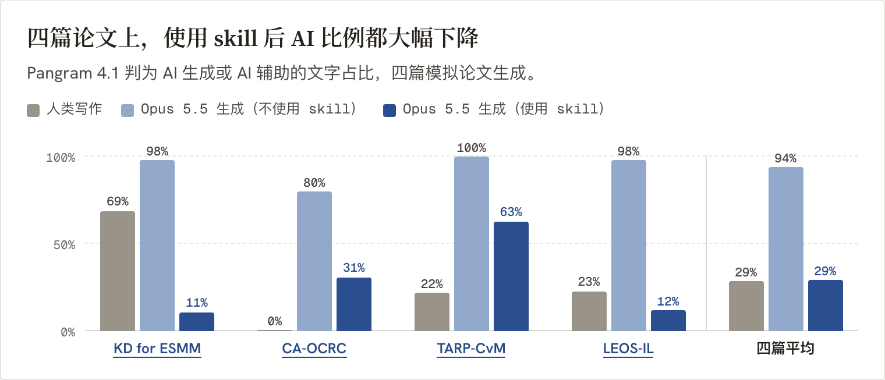
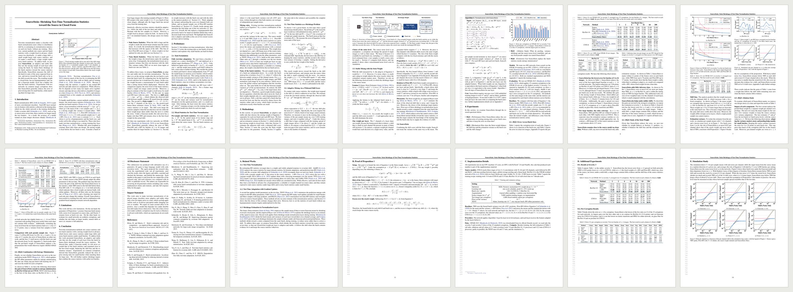

# 写作的艺术

**装备精心设计的 skill，写作智能体能骗过 AI 检测。**

[English](README.md) | 中文

[](LICENSE)
[](https://agentskills.io)
[](https://lehengthu.github.io/blog/2026/paper-skill-ai-detection/)

<a href="https://lehengthu.github.io/blog/2026/paper-skill-ai-detection/"></a>

`art-of-writing` 是一个写 ML 会议论文（ICLR、NeurIPS、ICML）的 agent skill。我们从人类撰写的规范论文中提炼写法，做成了流程、规则、短语库和检查工具。装备该 skill 的智能体能写出流畅有逻辑的文字，且能通过 AI 检测器，甚至能一次写完一篇会议论文。

完整研究见[博客](https://lehengthu.github.io/blog/2026/paper-skill-ai-detection/)，也可以看 [37 秒的开场影片](media/demo.mp4)。

## 结果



- **Pangram 很难认出使用 skill 生成的文本。**我们模拟了从草稿到成文的过程：在四篇论文上，Claude Opus 5.5 不使用 skill 时平均 94% 的文字被判为 AI，使用 skill 时只有 29%，与人类写作持平。
- **生成的文本符合学术规范。**skill 检查器找出的机器草稿口癖从 75 处降到 6 处。
- **一段提示词，一篇完整论文。**智能体只凭一段提示词，自己选定想法、跑实验，约 82 分钟独立写成一篇排好版的 ICML 2027 投稿。
- **Skill 代替不了人的思考。**如果内容本身就是 AI 生成的，用 AI 改也纠正不过来：只给题目写成的论文仍是 100% AI。一次完整生成的论文尽管读起来像人写的，但因为篇幅过长，仍然会被判为 AI。

> [!CAUTION]
> **适用范围：**能通过检测的，一般是基于人写草稿的较短文本；直接由 AI 生成或篇幅较长的文章，被判为 AI 的比例仍然较高。

## 高级用法：一段提示词，一篇完整论文

Skill 还能带着智能体把一个想法写成排好版的投稿。装备 skill 的 Claude Opus 5.5 只凭一段提示词，一次运行就写成了 14 页的 ICML 2027 投稿 [SourceStein](examples/sourcestein-icml2027/README.zh-CN.md)：共 209 轮、约 82 分钟，其中约 37 分钟是它在一台只有 CPU 的 Mac 上自己跑的实验，全程没有人工修改。

<a href="examples/sourcestein-icml2027/README.zh-CN.md"></a>

[阅读论文](examples/sourcestein-icml2027/SourceStein.pdf) · [提示词](examples/sourcestein-icml2027/prompt.md) · [源码、代码和实验结果](examples/sourcestein-icml2027/source/)

> [!CAUTION]
> **风险提示：**对于一次完整的生成，尽管写出来像是人类写的，但因为篇幅过长，仍然会被判为 AI。

## 安装

**Claude Code**（插件市场）：

```
/plugin marketplace add LehengTHU/art-of-writing
/plugin install art-of-writing@art-of-writing
```

**其他智能体**（Codex、Cursor、Gemini CLI 等读取 `SKILL.md` 的工具）：

```bash
npx skills add LehengTHU/art-of-writing
# 或者用 GitHub CLI
gh skill install LehengTHU/art-of-writing art-of-writing
```

**手动安装：**

```bash
git clone https://github.com/LehengTHU/art-of-writing
cp -r art-of-writing/skills/art-of-writing ~/.claude/skills/
```

检查器需要 Python 3.8+，编译论文需要一个 LaTeX 引擎（[tectonic](https://tectonic-typesetting.github.io) 体积最小）。手动安装后，运行 `bash ~/.claude/skills/art-of-writing/scripts/check_env.sh` 会列出缺少的依赖，并编译一页测试 PDF。完整的环境配置见 [`skills/art-of-writing/README.md`](skills/art-of-writing/README.md)。

## 用法

直接用自然语言提要求，写论文相关的任务会自动触发 skill。例如：

- “把 `notes.md` 里的方法笔记和实验结果写成一篇完整的 ICLR 论文。”
- “按这个风格重写 `chapters/1_introduction.tex` 的引言。”
- “用 `results.csv` 做主结果表，缺的实验留空。”
- “规划一篇 ICML 投稿的页数预算，告诉我哪些内容放附录。”
- “对照风格检查表审一遍我的草稿。”

检查器也可以单独运行：`python3 skills/art-of-writing/scripts/check_paper.py <论文目录> --stage submission`。

## 包含什么

| 路径 | 内容 |
|---|---|
| `SKILL.md` | 从研究提案到成稿的 8 步流程，以及风格检查表 |
| `references/` | 会议篇幅与页数预算、论文类型、结构、行文规则、引言的论证链、核心概念、数学、实验、图表、LaTeX 规范和带注释的例子 |
| `assets/lexicon/` | 短语库：从论文中摘出的 1,272 条表达，每条都有出现次数和状态（常用、偶用、已弃用、仅参考、禁用） |
| `tools/` | `ps.py` 查询短语的出现次数，背后是随 skill 发布的词序列计数索引，不含任何句子；`build_corpus.py` 和 `ngrams.py` 可以用你自己的论文建立同样的索引 |
| `scripts/check_paper.py` | 逐行报告字数预算、页数上限、必需声明、句子结构和 27 种机器草稿口癖 |
| `templates/` | ICLR、NeurIPS（单栏）和 ICML（双栏）的 LaTeX 工程、表格模板、绘图样式和 TikZ 框图样式 |

## 使用须知

- 能通过检测器的草稿仍然是大模型写的草稿。ICLR 等会议要求披露对大模型的使用，用这个 skill 写的论文同样适用。
- 检测分数不该用来判定作者身份。
- 论文写什么、怎么论证，仍要由你来想。智能体写的每一部分都要读过、改过。

## 引用

```bibtex
@misc{sheng2026paperskill,
  title        = {The Art of Writing: Agents with Well-Curated Skills Can Cheat AI Detectors},
  author       = {Sheng, Leheng and Zhang, An and Wang, Xiang},
  year         = {2026},
  howpublished = {Blog post},
  url          = {https://lehengthu.github.io/blog/2026/paper-skill-ai-detection/}
}
```

## 致谢

感谢我的导师王翔、张岸提供蒸馏论文的许可，感谢早期使用者的反馈，感谢我的女朋友赵谢杨对 blog 设计的支持与帮助。

## 许可证

[MIT](LICENSE)
