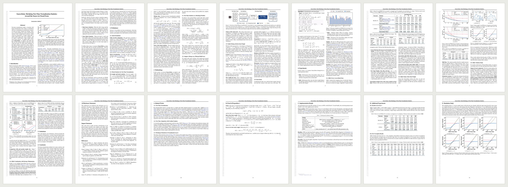
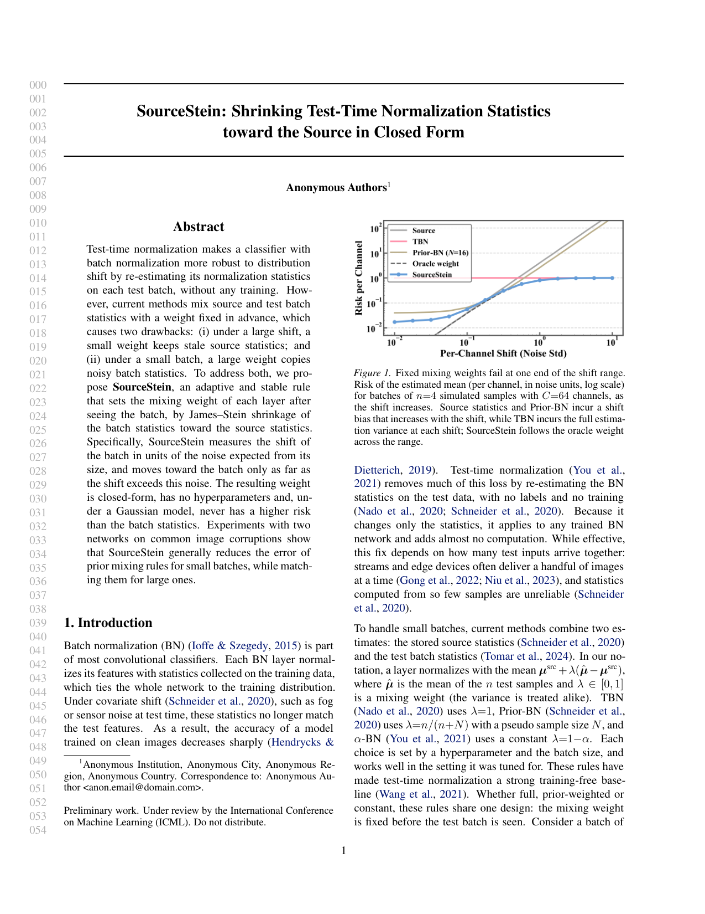

# SourceStein: a complete ICML paper from one prompt

English | [中文](README.zh-CN.md)

With the art-of-writing skill, Claude Opus 5.5 turned one prompt into a typeset ICML 2027 submission in a single run. It chose the idea, wrote the code, downloaded the data, trained two networks, ran the experiments, drew the figures, checked each reference on the web and built the paper. Nobody edited the result.

[**Read the paper (PDF)**](SourceStein.pdf) · [The prompt](prompt.md) · [Source, code and results](source/)

## The paper

*SourceStein: Shrinking Test-Time Normalization Statistics toward the Source in Closed Form* studies how test-time normalization should mix the source statistics with those of the test batch. It has 14 pages: eight of main text, which end exactly at the 8-page limit, one of statements and references, and five of appendix. The paper carries an AI disclosure statement.

## The run

| | |
|---|---|
| Model | Claude Opus 5.5 in Claude Code, non-interactive mode |
| Tools | read and write files, run commands, search and fetch web pages; no subagents |
| Machine | a CPU-only Mac with 15 cores and no GPU |
| Turns | 209 (limit 600) |
| Time | about 82 minutes, 37 of them for the experiments |
| API cost | $19.91 |
| Human intervention | none |

## Checks

- The paper builds with tectonic with 0 errors, 0 undefined references and 0 overfull boxes.
- `check_paper.py` places the end of the main text on page 8 (limit 8) and reports 0 lint hits. Its 7 habit warnings all flag "shrink", the standard term for James–Stein shrinkage.
- Each number we spot-checked in the tables and the text matches the raw outputs in [`source/results/`](source/results/). The agent fixed the method and the settings before it saw the first result, and the paper reports where the results miss its expectations.

## Caveats

- No human has reviewed the paper, and it was not submitted. The experiments are small: two compact networks on CIFAR-10-C.
- The "Under review" footer is the default text of the ICML template.
- **Risk: for a complete generation, although the writing reads as human, it is still labeled AI because of its length.**

## Rebuild

`source/` holds the agent's project as it left it, without the ICML style kit and the downloaded data. To rebuild the PDF, download the [ICML 2027 style kit](https://icml.cc) into `source/` and run `tectonic -X compile example_paper.tex`. The experiment scripts are in [`source/code/`](source/code/), and [`source/NOTES.md`](source/NOTES.md) lists which result file each number comes from. Local paths in the logs are shortened to `<paper>`.
