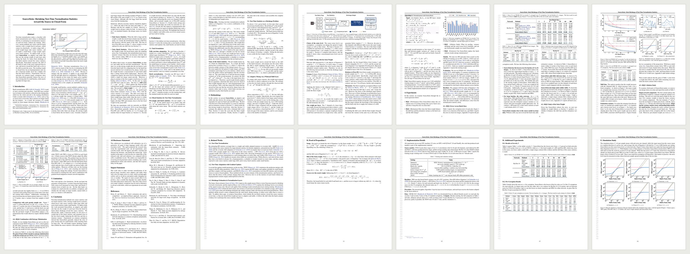
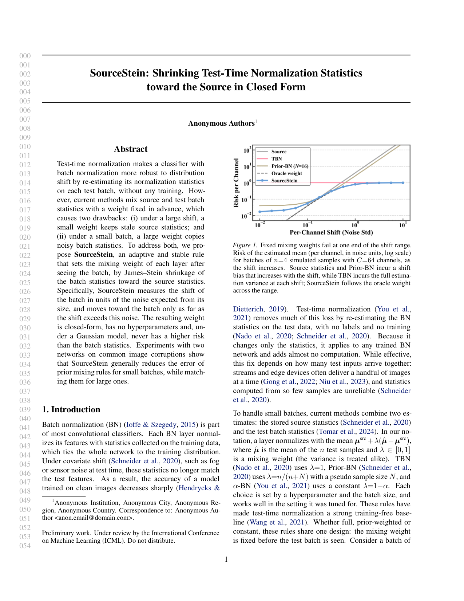

# SourceStein：一段提示词写成的完整 ICML 论文

[English](README.md) | 中文

装备 humanize-ml-paper skill 的 Claude Opus 5.5 只凭一段提示词，一次运行就写成了一篇排好版的 ICML 2027 投稿。它自己选定想法、写代码、下载数据、训练两个网络、跑实验、画图、上网逐条核对参考文献，最后编译出论文，全程没有人工修改。

[**阅读论文（PDF）**](SourceStein.pdf) · [提示词](prompt.md) · [源码、代码和实验结果](source/)

## 论文

《SourceStein: Shrinking Test-Time Normalization Statistics toward the Source in Closed Form》研究测试时归一化如何混合源域和测试 batch 的统计量。论文共 14 页：正文 8 页，正好写满 8 页上限；声明与参考文献 1 页；附录 5 页。论文里有一段 AI 使用声明。

## 运行情况

| | |
|---|---|
| 模型 | Claude Opus 5.5，Claude Code 非交互模式 |
| 工具 | 读写文件、运行命令、上网搜索和抓取网页；不能启动子智能体 |
| 机器 | 一台只有 CPU 的 Mac（15 核，没有 GPU） |
| 轮数 | 209 轮（上限 600） |
| 耗时 | 约 82 分钟，其中实验约 37 分钟 |
| API 费用 | 19.91 美元 |
| 人工干预 | 无 |

## 检查

- 用 tectonic 编译，0 个错误、0 个未定义引用、0 个溢出的行。
- `check_paper.py` 显示正文结束在第 8 页（上限 8 页），风格检查 0 处问题；7 条口癖提示都是 “shrink”，这是 James–Stein 收缩估计的标准术语。
- 我们抽查的表格和正文数字都能在 [`source/results/`](source/results/) 的原始输出里对上；方法和实验设置在看到第一份结果前就已定好，与预期不符之处论文也如实报告了。

## 注意

- 论文未经人工审阅，也没有投稿；实验规模很小，只有两个小网络和 CIFAR-10-C。
- 页脚的 “Under review” 是 ICML 模板的默认文字。
- **风险提示：对于一次完整的生成，尽管写出来像是人类写的，但因为篇幅过长，仍然会被判为 AI。**

## 重新编译

`source/` 保留了智能体留下的完整工程，只去掉了 ICML 模板文件和下载的数据。要重新编译，把 [ICML 2027 模板](https://icml.cc) 下载到 `source/` 里，运行 `tectonic -X compile example_paper.tex`。实验脚本在 [`source/code/`](source/code/)，[`source/NOTES.md`](source/NOTES.md) 列出了每个数字来自哪个结果文件。日志里的本地路径已缩写为 `<paper>`。
